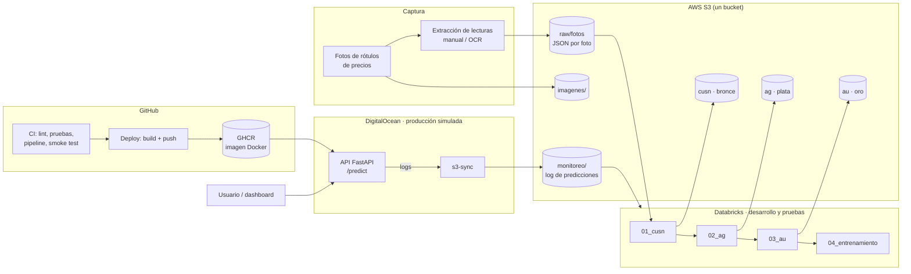

# Arquitectura

## Vista general



## Capas medallón

| Capa | Nombre | Contenido | Reglas |
|---|---|---|---|
| raw | `raw/fotos/fecha=AAAA-MM-DD/*.json` | Un JSON por foto con las lecturas tal como se capturaron | Inmutable. Se escribe a `.tmp` y se renombra |
| bronce | `cusn.lecturas` | Una fila por lectura, sin transformar, + `_source_file` y `_ingested_at` | No se corrige nada |
| plata | `ag.precios` | Precio numérico, combustible y departamento normalizados, sin duplicados | Validación obligatoria antes de publicar |
| oro | `au.precios_semanales`, `au.precio_nacional`, `au.modelo`, `au.ultima_semana` | Agregados para dashboard y tabla de entrenamiento | `au.modelo` debe tener ambas clases y sin nulos |

## Dónde corre cada cosa

| Paso | Local / CI | Databricks | DigitalOcean |
|---|---|---|---|
| raw → cusn → ag → au | `gasolina pipeline` (pandas) | notebooks `01`–`03` (Spark) | — |
| Entrenamiento | `gasolina train` | notebook `04` (mismo paquete) | — |
| Serving | `make serve` / `make up` | — | contenedor `api` desde GHCR |
| Monitoreo | `gasolina monitor` | lee `monitoreo/` en S3 | `s3-sync` sube los logs |

La lógica de pandas y la de Spark deben dar el mismo resultado. La versión en pandas es la que
se prueba en CI, y los notebooks son su traducción a Spark.

## Contrato de la API

`POST /predict`

```json
{"series": [{"departamento": "Petén", "combustible": "diesel",
             "precios": [29.85, 30.02, 30.31, 30.64]}]}
```

`precios` son los promedios de las últimas 4 semanas, del más antiguo al más reciente. Respuesta:

```json
{"model_version": "20261114231735",
 "predicciones": [{"departamento": "Petén", "combustible": "diesel", "precio_actual": 30.64,
                   "probabilidad_sube": 0.71, "prediccion": "sube"}]}
```
